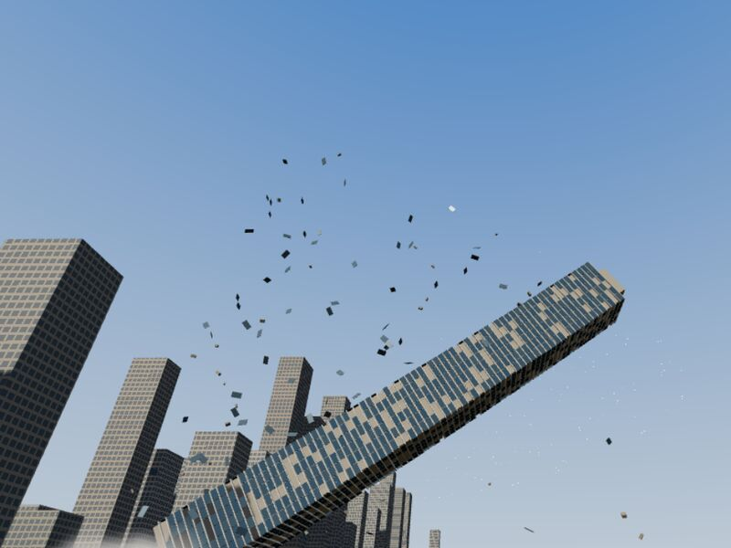
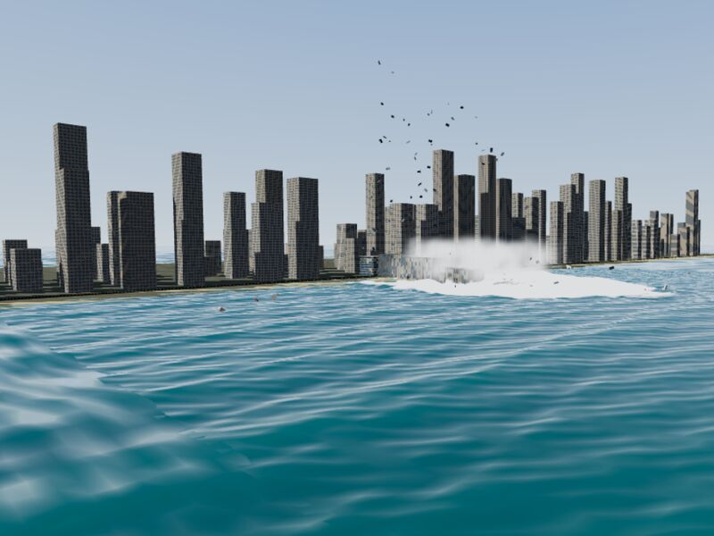
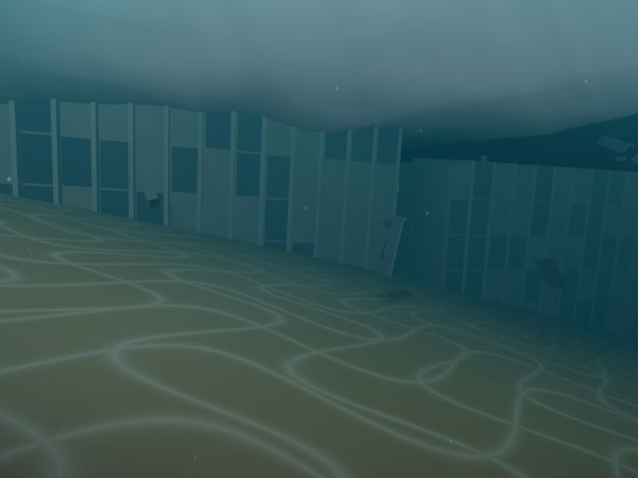

# Destruction Dynamics

A browser-native framework for cinematic destruction and water interaction, in
TypeScript on Three.js and Rapier. MIT licensed.

The idea: **author the spectacle, simulate what you interact with, and keep
the cost bounded.** A landmark collapse follows an authored path with an exact
timeline. Secondary pieces are real rigid bodies inside a hard budget. The
water combines an interactive solver with art-directed surges. The whole event
is a pure function of event time plus a seed, so it can be scrubbed, replayed,
saved, restored and synchronised over a network.

The first scenario is **The Deep End**: a fictional 85-storey tower on a
Balneário Camboriú-style beachfront tips into the Atlantic, raises a surge,
and settles as a wreck you can swim around.





*Screenshots are from the automated Chromium run (software rendering, Balanced preset).*

## Run it

Requires Node 22.12 or later.

```sh
npm install
npm run dev          # playground at http://localhost:5173
```

Open the page and press **Play** to start the event: a 5 s cancellable
preparation, then the collapse. **Trigger now** skips the preparation. Set
**Speed** to 4× or 8× to see the whole sequence quickly. Try the Underwater
camera after the impact: drag to look, WASD to swim, E/Q to rise and sink,
Shift to go faster.

```sh
npm run build        # static site in apps/playground/dist (relative paths; host anywhere)
npm run preview      # serve the build at http://localhost:4173
npm test             # unit and headless integration tests (Vitest)
npm run test:e2e     # browser end-to-end tests (Playwright, Chromium)
npm run bench        # CPU benchmarks → benchmarks/results/latest.json
npm run check        # typecheck + lint + format check + unit tests
```

`?quality=dorito|balanced|high|cinematic` in the URL sets the starting preset.

## Status

This is the result of the first implementation cycle: Milestones 1–3, plus a
first pass at parts of Milestone 4. Each row says how far it has been verified.

| Capability | Status | Evidence |
|---|---|---|
| Event director: versioned `dd-event/1` schema with validation, lifecycle `INTACT → … → RESTORATION → INTACT`, cancellation before commit, pause/resume/restart, time scale, scrubbing, save/load, seeded per-cue randomness | Implemented, tested | `packages/events/test/director.test.ts` |
| Deterministic replay of recorded control sequences; cues fire at the same authored times at any frame rate | Implemented, tested | same |
| Server-authoritative event state (`EventAuthority`) and client reconstruction for late joiners (`AuthoritySync`) | Implemented, tested (in-process; no transport) | same |
| 24 h real-world restoration (configurable: real-world, event-time or manual), restore-now | Implemented, tested, demonstrated | director tests, e2e |
| Authored tower collapse: stump plus 5 tipping sections, an inverted-pendulum tip remapped to the timeline, inter-section lag and whip, seeded wreck on the seabed, rewind on restoration | Implemented, tested, demonstrated | `packages/destruction/test`, e2e |
| Facade failure plan (≈1000–3400 panels, seeded, scrubbable) feeding budgeted Rapier debris, plus glass particles | Implemented, tested, demonstrated | same |
| Floor layers by fidelity: 5 / 12 / 26 / 77 layers (one per floor at Cinematic). From impact, each layer is its own rigid body with breakable slab joints, flooding buoyancy and seabed contact, precomputed in a Web Worker | Implemented, tested, demonstrated | `packages/destruction/test/layers.test.ts`, e2e test 9, [ADR 0009](docs/DECISIONS/0009-floor-layers.md) |
| Collision states (static intact, then kinematic while falling, then static wreck), derived from event time so they survive seeks and loads | Implemented, tested | destruction tests, `apps/playground/test` |
| Physics adapter contract with Rapier and a dependency-free fallback | Implemented, tested | `packages/physics/test/contract.test.ts` |
| Hybrid ocean: far-field Gerstner waves, a near-field linearised shallow-water solver (depth-dependent speed, land walls, sponge, foam advection), authored stadium-shaped impact surges, `WaterImpactEvent` input | Implemented, tested, demonstrated | `packages/fluids/test`, e2e |
| Buoyancy and drag for floating props and debris | Implemented, tested | fluids tests (a half-density box floats half submerged in Rapier) |
| Spray, mist, dust, glass, sparks, bubbles, foam particles | Implemented, demonstrated | `packages/rendering/test/particles.test.ts` (simulation only) |
| Underwater camera: fog and absorption, Snell's window, caustics, sediment, swim controls with wreck and seabed collision | Implemented, demonstrated | e2e test 8 |
| Six camera modes, including director shots from camera cues and shake | Implemented, demonstrated | e2e tests 2 and 8 |
| Quality presets (Potato / "Dorito Mode", Balanced, High, Cinematic) that change real budgets | Implemented, tested | e2e test 9, integration test |
| Budget governor: degrades particles, debris and fluid rate when frames run long; never the event itself | Implemented, tested | core and integration tests |
| World tiles (500 m, ENU), activation leases, saveable per-tile overrides | Implemented, tested | `packages/core/test` |
| Spatial audio: procedural placeholder layers, HRTF panning, speed-of-sound delay, underwater low-pass | Implemented; routing tested; sound **not** verified by a test | `packages/audio/test` |
| WebGPU renderer | Planned. WebGL2 only today; the HUD reports when WebGPU is available | [ADR 0002](docs/DECISIONS/0002-webgl2-first-webgpu-later.md) |
| Rust/WASM simulation crate | Planned, now justified by data: the near-field fluid step is the largest CPU cost | [ADR 0004](docs/DECISIONS/0004-typescript-first-wasm-when-measured.md) |
| Navigable building interiors, diver vehicle, cargo pods (Milestone 6) | Planned | [roadmap](docs/ROADMAP.md) |
| São Paulo bridge scenario (Milestone 8) | Planned | roadmap |
| Multiplayer transport | Planned. The state model is in place | [ADR 0006](docs/DECISIONS/0006-server-authoritative-events.md) |

**Performance.** Measured CPU costs are in
[docs/PERFORMANCE_TARGETS.md](docs/PERFORMANCE_TARGETS.md). Real-GPU frame
rates have **not** been measured yet. The automated runs use software
rendering (SwiftShader), which says nothing about real GPU performance. The
per-tier FPS targets are targets, not claims.

## Layout

```
packages/core         math, seeded RNG, frames (ENU ↔ scene), quality presets, budgets, world tiles
packages/events       event schema + validator, EventDirector, authority sync, recording/replay
packages/physics      PhysicsAdapter contract, Rapier backend, simple fallback backend
packages/destruction  destruction interfaces, tower layout + authored collapse, facade plan, debris pool, collision states
packages/fluids       FluidAdapter contract, Gerstner far field, shallow-water near field, surges, buoyancy
packages/rendering    Three.js views: ocean, sky, terrain, city, tower, debris, particles, underwater, debug draw
packages/audio        AudioEngine contract, cue router, procedural WebAudio engine
scenarios/            The Deep End: event definition (JSON) and layout
apps/playground       the browser playground (Vite)
tests/e2e             Playwright suite
benchmarks/           CPU benchmarks
docs/                 architecture, research, decisions (ADRs), roadmap, performance, integration
```

## Documentation

- [Architecture](docs/ARCHITECTURE.md)
- [Integration guide](docs/INTEGRATION.md): embedding the packages and connecting world tiles, physics, water and audio
- [Research](docs/RESEARCH.md): repository survey, techniques considered and references
- [Dependencies](docs/DEPENDENCIES.md)
- [Performance targets and measurements](docs/PERFORMANCE_TARGETS.md)
- [Roadmap](docs/ROADMAP.md)
- [Decisions](docs/DECISIONS/)

## Content and safety notes

Every event here is fictional entertainment. The tower's failure is authored
and has fictional triggers. Nothing in this repository models how real
buildings or bridges fail, how demolition works, or how salvage operations are
carried out. All geometry and sound is procedural. See
[LICENSE-THIRD-PARTY.md](LICENSE-THIRD-PARTY.md).

## License

MIT, see [LICENSE](LICENSE).
